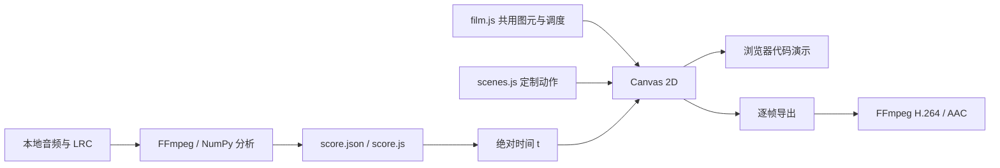

# 技术如何保留创作决定

## 数据和渲染链路



原始制作在本地从提供的 NCM 提取音频。公开复现入口接受标准音频文件和 LRC，避免绑定原作者的电脑路径。现有 score 数据已经随仓库提供，不重新分析也能运行全部视觉内容。

## 共用机制与专门动作

`src/film.js` 提供 `line()`、`polygon()`、`torn()`、`halftone()`、`ticket()` 和字体绘制等共用机制，负责圆城、吉他、蓝图与时间调度。`src/scenes.js` 提供灯箱、地图、收音机、相册、夜街、工作台、歌声送达、桥梁和到站的定制动作。

两个文件共享同一闭包。构建时，`tools/runtime.mjs` 将 `scenes.js` 放入 `film.js` 的 `/* REVISION_SCENES */` 标记处，再与 `score.js` 一起写进单文件播放器。共享图元保证票根身份和材质稳定，独立场景函数保留不同段落的动作方式。

## 绝对时间、窗口与确定性

```js
const win = (t, start, duration) => ease((t - start) / duration);
UtopiaFilm.render(t);
```

场景中的动作窗口由绝对时间计算。齿轮、票根、公交位置、翻页和消息路线不依赖渲染调用次数。固定种子的细节函数使纸纹、撕边和网点在跳转时保持稳定。

原核心代码中的事件时间仍有部分直接写在场景函数里，score 保存歌词与包络，`stageName(t)` 保存场景边界。这个实现并未把所有动作时间完全数据化。修改关键时点时，需要同时核对调度、场景窗口与歌词数据。

有配乐时，播放器直接从 `audio.currentTime` 读取视觉时间。静音公开演示使用 `performance.now()` 推进时间；加载本地配乐后切换回媒体时钟。离线导出始终采用帧号除以 60，避免录屏掉帧改变成片时长。

## 音频特征的作用与限制

本地分析将音频转为 22,050 Hz 单声道 PCM，使用 2,048 样本窗和 220 样本步长计算 FFT。保存的特征包括：

| 特征 | 分析范围 / 方式 | 在作品中的作用 |
| --- | --- | --- |
| bass | 35–180 Hz | 票根受力等局部形变 |
| body | 180–1,500 Hz | 可供场景读取的中频能量 |
| air | 1,500–8,000 Hz | 灯线、波纹和声音路线的局部变化 |
| RMS | 时域均方根 | 整体能量数据 |
| onset | 频谱正向变化 | 瞬态数据，供节奏测量及动作设计参考 |

节拍候选来自 onset 自相关，周期和相位再作搜索。最终估计为约 **122.002 BPM**、**0.120 秒相位**。`hit(t)` 根据估计周期生成衰减脉冲；它不是逐个确认的鼓点检测结果。源码保存多个频段不意味着所有频段都同等驱动了画面。

歌词是行级 LRC。第二次“但别再把小刀带在身上”的原时间为 84.85 秒，排在 87.73 秒之后；暂定改为前后相邻行时间的中点 **89.665 秒**。原时间、暂改时间及依据保存在 score 的 `repairs` 中。这不是经过听辨的逐字对齐。

## Canvas 里的空间和材料

纸张边缘由稳定的扰动点构成；纤维纸纹使用可重复的小画布纹理；网点通过裁切区域内的规则圆点绘制。阴影、印刷套色和撕边承担材料层次。

圆城通过角度排列建筑。夜街通过远近尺度、遮挡和投影后的平面线条产生纵深。翻页通过平面变换、压缩与遮挡建立纸面变化。它们都是二维绘制；没有 Three.js、WebGL、SVG 或真实三维摄像机。

## 复现流程

1. 安装 Node.js 20+，执行 `npm install`。
2. 直接 `npm run build`；双击 `index.html` 可运行静音演示，也可选择本地配乐。
3. 安装系统 Chrome / Chromium，或执行 `npx playwright-core install chromium`。
4. `npm run frames` 输出全片关键画面；`npm run verify` 检查公开播放器。
5. 需要完整配乐导出时，将同版音频放在 `assets/song.mp3`，或者执行下面的准备命令。

```bash
npm run prepare -- --audio "/path/to/song.mp3" --lyrics "/path/to/song.lrc"
python -m pip install numpy
npm run analyze
npm run build
npm run render
```

准备和重新分析会替换歌词、音频以及 score。既有场景仍按本作品时间表调度；换一首歌需要重新编排，不能只替换媒体文件。

可使用以下环境变量：

| 变量 | 用途 |
| --- | --- |
| `CHROME_PATH` | 浏览器可执行文件 |
| `FFMPEG_PATH` | FFmpeg 可执行文件；默认从 PATH 查找 |
| `FFPROBE_PATH` | FFprobe；默认取 FFmpeg 相邻目录或 PATH |
| `UTOPIA_FONT_PATH` | 本地可使用的 WOFF2 字体，构建时嵌入 |
| `CUA_MODULES` | 可选的现有 Node 依赖目录 |

没有本地字体文件时使用系统中文字体。原电影已经定稿；公开环境中的字形差异不会改动 Release 中的原始 MP4。源码帧导出可能需要较长时间，最终文件保存在 `output/`。

## 交付证据

最终视频有 6,896 帧，时长 114.933333 秒，1920 × 1080，60 fps，H.264 视频和 AAC 双声道音频。

保存的原交付检查覆盖编码后全片有序画面、高潮连续动作、两个播放器的播放和定位、任意时间复现，以及源码包一致性。仓库对照文件额外确认六份核心源码 / 数据与已经交付的 V2 逐字节一致；路径适配与静音演示单独验证。

验证记录支持的是这些具体技术结论。没有完成直接听觉复核，也没有验证逐字歌词时间。创作者对观看效果的反馈属于其实际观看后的判断。
